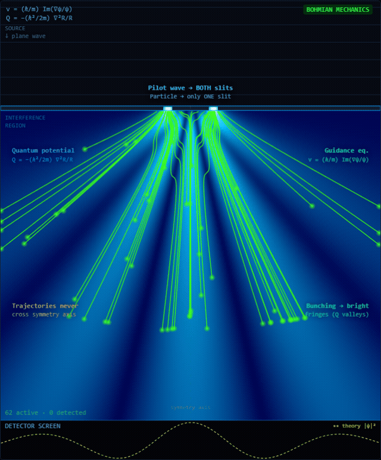
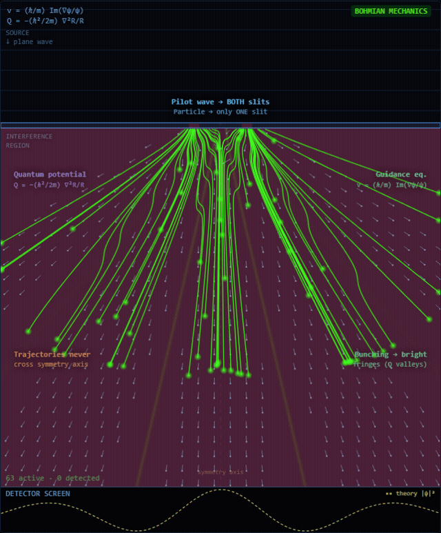
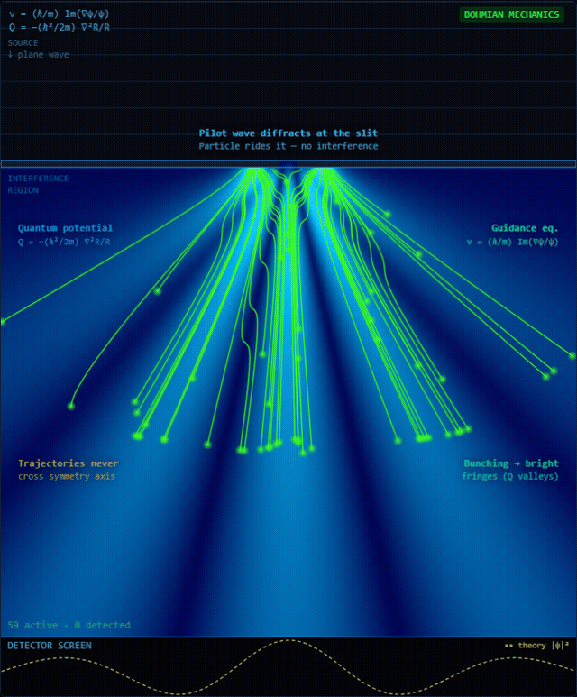
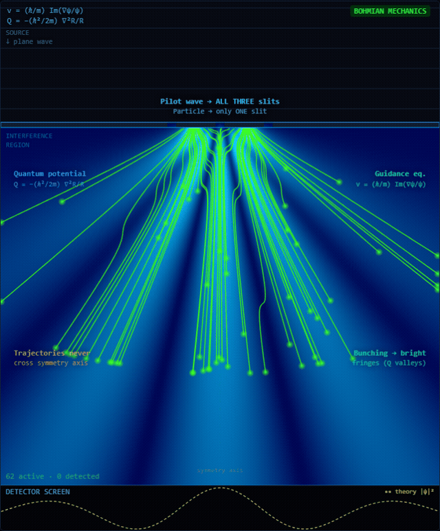
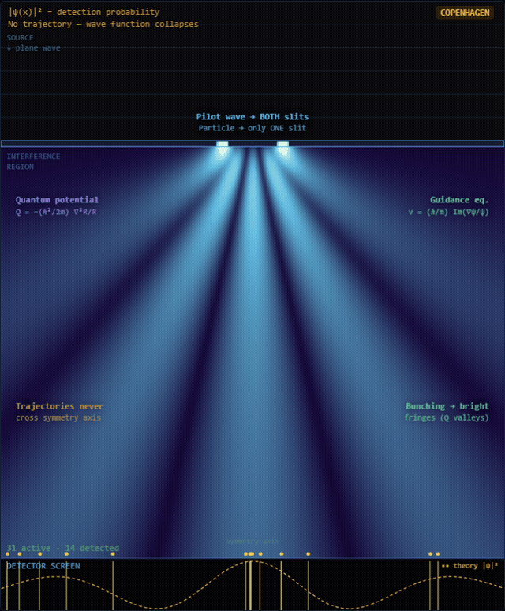

# Bohmian Mechanics — Double-Slit Experiment


An interactive visualisation of the double-slit experiment from the perspective of David Bohm's pilot wave theory (de Broglie-Bohm / Bohmian mechanics).

Particles have definite positions at all times. Their trajectories are guided by a real physical field — the pilot wave ψ — through the quantum potential Q. The interference pattern is not a mystery; it is the natural consequence of Q's topology.

## What you're seeing

| Element | Description |
|---|---|
| **Blue field** | The pilot wave \|ψ\|² — probability density. Passes through ALL slits simultaneously |
| **Green trajectories** | Deterministic Bohmian particle paths guided by v = (ħ/m) Im(∇ψ/ψ) |
| **Detector strip** | The fringe pattern building up particle by particle, with the theoretical \|ψ\|² curve overlaid for comparison |
| **Q potential** (toggle) | Quantum potential Q = −(ħ²/2m)∇²R/R — the non-local field that organises trajectories |
| **Flow field** (toggle) | The guidance velocity field as arrows — the "current" every particle rides |

### Key Bohmian features shown

- **Trajectories never cross the symmetry axis** — provable from the guidance equation
- **Bunching into bright fringes** — Q has valleys at high \|ψ\|² regions, pulling particles in
- **No wave function collapse** — the wave is a real field; detection is just a particle reaching the screen
- **Copenhagen contrast** — toggle to see the same field with no trajectories, particles "teleporting" to the detector



*Q potential (plasma overlay) and the guidance flow field together — particles ride the arrows straight into Q's valleys.*

## Physics

The guidance equation determines particle velocity from the wave function:

```
v = (ħ/m) · Im(∇ψ / ψ)
```

The quantum potential is derived from the amplitude R = |ψ|:

```
Q = −(ħ²/2m) · ∇²R / R
```

The wave function is computed via Huygens-Fresnel superposition with the Rayleigh-Sommerfeld obliquity factor cos θ, using adaptive source counts per slit (source spacing stays far below λ/2, so the discretisation is exact for display purposes while staying fast enough to recompute live as you drag a slider). The guidance velocity comes purely from the phase gradient — the outgoing-wave kernel already carries the forward momentum ħk, so no drift term is added. Near wave nodes the true Bohmian speed diverges; the field is regularised and speed-capped so the fixed-step 4th-order Runge-Kutta integrator stays stable while keeping the characteristic whip around dark fringes.

### One slit, two slits, three slits



*Single slit: pure diffraction. No second path to interfere with, so no fringes — only the diffraction envelope.*



*Three slits sharpen the primary maxima and add faint secondary maxima between them — the same physics as a diffraction grating, one slit at a time.*

### Bohm vs. Copenhagen



*Toggle to Copenhagen and the trajectories vanish — particles simply appear at the detector, Born-rule sampled from \|ψ\|², with no path in between.*

## Controls

| Control | Effect |
|---|---|
| Slits (1 / 2 / 3) | Single-slit pure diffraction, the classic double slit, or a triple-slit grating |
| Slit width | Narrower = wider diffraction, fewer fringes. Updates live while dragging |
| Separation | Larger = more fringes packed closer. Updates live while dragging |
| Presets | Classic · Wide fringes · Fine fringes · Single slit · Triple slit |
| Interpretation | Toggle Bohm (trajectories) vs Copenhagen (probability cloud only) |
| Wave shows | \|ψ\|² probability density or Re(ψ) oscillating crests |
| Layers | ψ wave · Q potential · Flow field · Trajectories · Labels · Axis |
| Fire burst / Fire 1 / Clear | Launch particles sampled from the Born distribution |
| Speed / Pause / Auto-fire | Simulation pacing |
| 3D Perspective | CSS perspective transform — drag to rotate the view |

Keyboard: **space** pause · **f** fire burst · **c** clear · **q** toggle Q · **t** toggle trajectories.

Hover any control for a plain-English explanation of what it does physically. Hover the canvas for a live readout of \|ψ\|², Q and v at the cursor.

## Stack

- Vite + TypeScript — no framework, zero runtime dependencies
- HTML5 Canvas 2D (HiDPI/retina aware), static fields cached offscreen; finished trajectories are stamped once onto a persistent layer so per-frame cost scales with active particles only
- Pure physics: no physics library, all equations derived from first principles

## Running locally

```bash
npm install
npm run dev
```

Open [http://localhost:5173](http://localhost:5173).

## References

- Bohm, D. (1952). *A Suggested Interpretation of the Quantum Theory in Terms of "Hidden" Variables*. Physical Review, 85(2), 166-179.
- Holland, P.R. (1993). *The Quantum Theory of Motion*. Cambridge University Press.
- Philippidis, C., Dewdney, C., & Hiley, B.J. (1979). *Quantum interference and the quantum potential*. Il Nuovo Cimento B, 52(1), 15-28. (The original Bohmian trajectory paper with the double-slit)
